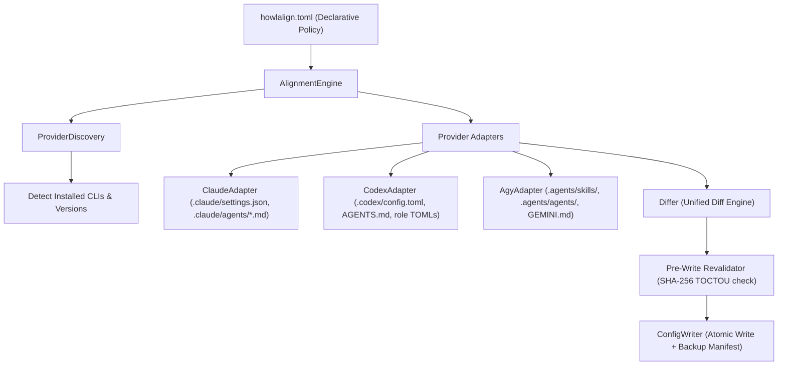

# HowlAlign Architecture

## 1. System Overview

HowlAlign is a provider-agnostic configuration and alignment engine for AI coding assistants. It translates a single, declarative engineering policy (`howlalign.toml`) into native, platform-specific configuration files across Claude Code, OpenAI Codex CLI, and Google Antigravity CLI (AGY).

## 2. Conceptual Roles

HowlAlign structures developer workflows into three neutral role classes:

1. **Planning Role:**
   - Focus: High-level system architecture, cross-module refactoring, design tradeoffs, security-sensitive architecture, complex bug investigation.
   - Model characteristics: Maximum reasoning depth and extended thinking capabilities.
   - Mappings:
     - Claude: `opusplan` router or `claude-opus-5` with high effort.
     - Codex: `gpt-6.1-sol` with `model_reasoning_effort = "high"` or `"ultra"`.
     - AGY: `gemini-3.8-flash-high` or `claude-opus-4-6-thinking`.

2. **Implementation Role:**
   - Focus: Active feature implementation, unit and integration test authoring, code hygiene, refactoring.
   - Model characteristics: Balanced reasoning and fast, accurate code generation.
   - Mappings:
     - Claude: `claude-sonnet-5` with medium effort.
     - Codex: `gpt-6.1-sol` with medium effort.
     - AGY: `gemini-3.8-flash-high`.

3. **Support Role:**
   - Focus: Targeted symbol lookups, documentation queries, test failure diagnosis, narrow research.
   - Model characteristics: Cost-effective, lower latency models.
   - Mappings:
     - Claude: `claude-haiku-4`.
     - Codex: `gpt-5.6-luna`.
     - AGY: `gemini-3.8-flash-medium`.

## 3. Specialized Subagents

Three neutral subagent definitions are translated into native provider constructs:

- **`search`:**
  - Role: Read-only codebase exploration, symbol definition and usage lookup, architectural mapping.
  - Native translations:
    - Claude Code: `.claude/agents/search.md` (`permissionMode: plan`, restricted tools).
    - Codex CLI: `.codex/agents/search.toml` mapped in `.codex/config.toml`.
    - AGY: `.agents/skills/search/SKILL.md` and `.agents/agents/search/agent.md`.

- **`tests`:**
  - Role: Executes test commands, captures exit codes and stdout/stderr, diagnoses failure points.
  - Native translations:
    - Claude Code: `.claude/agents/tests.md` (`permissionMode: acceptEdits`, tool `Bash` enabled).
    - Codex CLI: `.codex/agents/tests.toml`.
    - AGY: `.agents/skills/tests/SKILL.md` and `.agents/agents/tests/agent.md`.

- **`docs`:**
  - Role: Explores library, API, and ecosystem documentation, checks version compatibility.
  - Native translations:
    - Claude Code: `.claude/agents/docs.md` (`permissionMode: plan`, `WebFetch` and `WebSearch` enabled).
    - Codex CLI: `.codex/agents/docs.toml`.
    - AGY: `.agents/skills/docs/SKILL.md` and `.agents/agents/docs/agent.md`.

## 4. Configuration Precedence Layers

HowlAlign models configuration across three tiers:

1. **Global Scope (`--global`):**
   - User-level defaults applied across all repositories on the machine.
   - Locations:
     - Claude: `~/.claude/settings.json`
     - Codex: `~/.codex/config.toml`
     - AGY: `~/.gemini/antigravity-cli/settings.json`

2. **Project Scope (Default):**
   - Repository-specific conventions checked into version control or maintained in workspace root.
   - Locations:
     - Claude: `<repo>/.claude/settings.json`, `<repo>/CLAUDE.md`, `<repo>/.claude/agents/*.md`
     - Codex: `<repo>/.codex/config.toml`, `<repo>/AGENTS.md`, `<repo>/.codex/agents/*.toml`
     - AGY: `<repo>/GEMINI.md`, `<repo>/.agents/skills/`, `<repo>/.agents/agents/`

3. **Runtime Scope:**
   - Ad-hoc CLI arguments passed during assistant execution (e.g. `claude --effort high`, `codex exec -s workspace-write`).

## 5. Security & Isolation Architecture

Configuration files control critical developer tool behavior. HowlAlign enforces strict security guarantees:

1. **Preservation-Aware Updates & Provenance Fingerprinting:** When modifying JSON or TOML configurations, unrelated keys, tables, and settings are preserved. User-authored custom agents and guidelines lacking HowlAlign provenance markers are detected as conflicts and protected from overwrite. HowlAlign embeds SHA-256 content fingerprints (`# howlalign: fingerprint = ...` or frontmatter `fingerprint: ...`) in managed files; if a user subsequently customizes a managed subagent, HowlAlign detects the fingerprint divergence and prevents accidental overwrite.
2. **Atomic Writes & Permission Preservation:** File updates are written to hidden temporary files in the target directory, permissions are preserved on existing files, and atomically swapped using `os.replace` after `os.fsync`.
3. **Pre-Write Revalidation (Anti-TOCTOU):** The SHA-256 fingerprint of each file on disk is validated against the fingerprint recorded when the diff was generated. If a file was modified concurrently, the operation immediately aborts without touching remaining files.
4. **User-Private Backups & Manifest Lifecycle:** Backups are written outside repositories into `$XDG_STATE_HOME/howlalign/backups/<workspace_id>/<timestamp>/` (defaulting to `~/.local/state/howlalign/backups/`) with restrictive permissions (`0o700` for directories, `0o600` for files and manifests). Manifests maintain explicit transaction states (`in_progress`, `completed`, `rolled_back`, `failed`).
5. **Pre-Restore Backup Integrity Verification:** Before restoring any file, HowlAlign verifies that the backup file exists, is a regular file (rejecting symlinks inside backup directories), and matches the recorded `original_sha256`. Corrupted or tampered backups fail closed with `BackupCorruptedError`. The `--force` flag never bypasses backup integrity.
6. **Restore Safety & Drift Conflict Detection:** Restore validates manifest paths, enforces containment within authorized workspace/home roots, and verifies that target files match their `post_apply_sha256`. Post-apply modifications or file deletions require `--force` to overwrite. Unmanaged files created during apply are safely unlinked.
7. **Authorization-Controlled Cross-Mount Restore:** Restoring backups across workspaces or mount boundaries requires explicit user authorization via `--workspace <path>` / `-w <path>` to prevent malicious manifests from escaping authorized roots.
8. **Truthful Rollback Reporting & Scoped Preservation:** When an apply batch fails mid-process, in-memory rollback attempts to revert modified files and truthfully reports its outcome via typed `RecoveryState` (`SUCCEEDED`, `PARTIAL`, `FAILED`, `NONE`). The disk manifest is preserved rather than overwritten with truncated entries, marking status as `rolled_back`.
9. **Path Traversal & Symlink Protection:** Target file paths and symlink parent chains are strictly validated against authorized roots, raising `PathTraversalError` or `UnsafeSymlinkError` upon violation.
10. **Fail-Closed Configuration & Policy Safety:** Malformed existing configurations immediately halt alignment with `ConfigurationParseError` rather than resetting or wiping user settings. Policy files with unknown providers or invalid enum parameters fail closed with `PolicyValidationError`.
11. **Credential Masking & Diff Truthfulness:** Diagnostic routines and unified diff previews mask API keys, tokens, and authorization headers without recursive double-redaction. Diffs that change secrets emit explicit masked modification markers so previews remain non-empty and truthful without leaking secret bytes.

## 6. Managed-File Canonical Fingerprint Contract & Migration

In v0.1.3, HowlAlign establishes a unified, canonical contract for tracking provenance and detecting user edits across all managed markdown and TOML files:

### 1. Canonical Fingerprint Contract
- **Embedding:** `embed_managed_fingerprint(raw_content, format_type)` embeds the SHA-256 fingerprint:
  - For Markdown (`format_type="md"`): Inserted into YAML frontmatter as `fingerprint: "<sha256>"` if frontmatter exists, or appended as `<!-- howlalign: fingerprint = <sha256> -->`.
  - For TOML (`format_type="toml"`): Appended directly after the `# managed_by = "howlalign"` header as `# howlalign: fingerprint = <sha256>`.
- **Computation:** `compute_managed_fingerprint(content)` normalizes line endings (`\r\n` -> `\n`), strips the fingerprint line itself (matching `FINGERPRINT_LINE_REGEX`), and computes the SHA-256 digest of the remaining complete file text.
- **Verification:** `has_user_modifications(content)` extracts the stored fingerprint and compares it against `compute_managed_fingerprint(content)`. If the hash matches, the file is identified as untouched and eligible for updates.

### 2. Backward-Compatible v0.1.2 Migration
In v0.1.2, adapters computed fingerprints over partial bodies prior to prepending frontmatter or headers. To avoid breaking or misclassifying untouched v0.1.2 files as user conflicts, HowlAlign implements a conservative fallback check:
- `_matches_legacy_v012_fingerprint(content, stored_fp)` checks if the stored hash matches the legacy calculation over:
  - Markdown: Body content after YAML frontmatter (for Claude and AGY subagents) or markdown body after headers (AGY skills).
  - TOML: Raw TOML body excluding the top header comment line.
- If the legacy hash matches, the file is verified as an untouched legacy file. When policy updates occur, HowlAlign seamlessly regenerates the file using the canonical v0.1.3 format without manual intervention or conflict errors.
- If neither the canonical nor the legacy hash matches, `has_user_modifications` returns `True`, failing closed to guarantee human edits are never silently overwritten.

