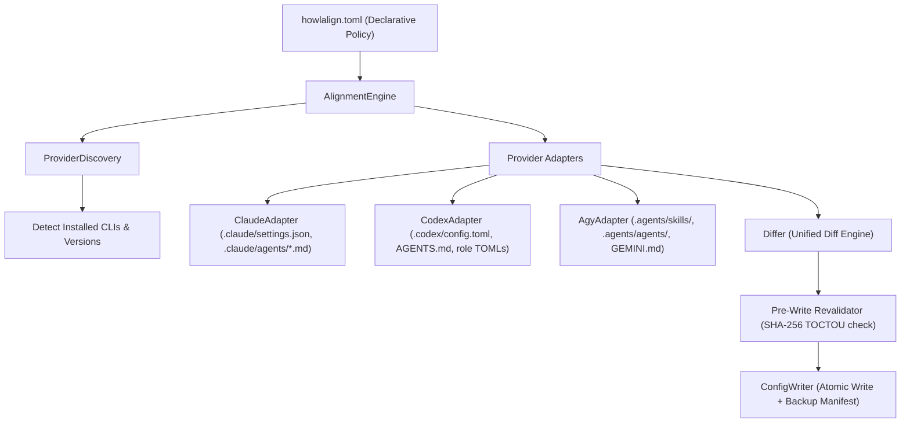

# HowlAlign Architecture

## 1. System Overview

HowlAlign is a provider-agnostic configuration and alignment engine for AI coding assistants. It translates a single, declarative engineering policy (`howlalign.toml`) into native, platform-specific configuration files across Claude Code, OpenAI Codex CLI, and Google Antigravity CLI (AGY).

## 2. Conceptual Roles

HowlAlign structures developer workflows into three neutral role classes:

1. **Planning Role:**
   - Focus: High-level system architecture, cross-module refactoring, design tradeoffs, security-sensitive architecture, complex bug investigation.
   - Model characteristics: Maximum reasoning depth and extended thinking capabilities.
   - Mappings:
     - Claude: `opusplan` router or `claude-opus-5` with high effort.
     - Codex: `gpt-6.1-sol` with `model_reasoning_effort = "high"` or `"ultra"`.
     - AGY: `gemini-3.8-flash-high` or `claude-opus-4-6-thinking`.

2. **Implementation Role:**
   - Focus: Active feature implementation, unit and integration test authoring, code hygiene, refactoring.
   - Model characteristics: Balanced reasoning and fast, accurate code generation.
   - Mappings:
     - Claude: `claude-sonnet-5` with medium effort.
     - Codex: `gpt-6.1-sol` with medium effort.
     - AGY: `gemini-3.8-flash-high`.

3. **Support Role:**
   - Focus: Targeted symbol lookups, documentation queries, test failure diagnosis, narrow research.
   - Model characteristics: Cost-effective, lower latency models.
   - Mappings:
     - Claude: `claude-haiku-4`.
     - Codex: `gpt-5.6-luna`.
     - AGY: `gemini-3.8-flash-medium`.

## 3. Specialized Subagents

Three neutral subagent definitions are translated into native provider constructs:

- **`search`:**
  - Role: Read-only codebase exploration, symbol definition and usage lookup, architectural mapping.
  - Native translations:
    - Claude Code: `.claude/agents/search.md` (`permissionMode: plan`, restricted tools).
    - Codex CLI: `.codex/agents/search.toml` mapped in `.codex/config.toml`.
    - AGY: `.agents/skills/search/SKILL.md` and `.agents/agents/search/agent.md`.

- **`tests`:**
  - Role: Executes test commands, captures exit codes and stdout/stderr, diagnoses failure points.
  - Native translations:
    - Claude Code: `.claude/agents/tests.md` (`permissionMode: acceptEdits`, tool `Bash` enabled).
    - Codex CLI: `.codex/agents/tests.toml`.
    - AGY: `.agents/skills/tests/SKILL.md` and `.agents/agents/tests/agent.md`.

- **`docs`:**
  - Role: Explores library, API, and ecosystem documentation, checks version compatibility.
  - Native translations:
    - Claude Code: `.claude/agents/docs.md` (`permissionMode: plan`, `WebFetch` and `WebSearch` enabled).
    - Codex CLI: `.codex/agents/docs.toml`.
    - AGY: `.agents/skills/docs/SKILL.md` and `.agents/agents/docs/agent.md`.

## 4. Configuration Precedence Layers

HowlAlign models configuration across three tiers:

1. **Global Scope (`--global`):**
   - User-level defaults applied across all repositories on the machine.
   - Locations:
     - Claude: `~/.claude/settings.json`
     - Codex: `~/.codex/config.toml`
     - AGY: `~/.gemini/antigravity-cli/settings.json`

2. **Project Scope (Default):**
   - Repository-specific conventions checked into version control or maintained in workspace root.
   - Locations:
     - Claude: `<repo>/.claude/settings.json`, `<repo>/CLAUDE.md`, `<repo>/.claude/agents/*.md`
     - Codex: `<repo>/.codex/config.toml`, `<repo>/AGENTS.md`, `<repo>/.codex/agents/*.toml`
     - AGY: `<repo>/GEMINI.md`, `<repo>/.agents/skills/`, `<repo>/.agents/agents/`

3. **Runtime Scope:**
   - Ad-hoc CLI arguments passed during assistant execution (e.g. `claude --effort high`, `codex exec -s workspace-write`).

## 5. Security & Isolation Architecture

Configuration files control critical developer tool behavior. HowlAlign enforces strict security guarantees:

1. **Preservation-Aware Updates & Provenance Fingerprinting:** When modifying JSON or TOML configurations, unrelated keys, tables, and settings are preserved. User-authored custom agents and guidelines lacking HowlAlign provenance markers are detected as conflicts and protected from overwrite. HowlAlign embeds SHA-256 content fingerprints (`# howlalign: fingerprint = ...` or frontmatter `fingerprint: ...`) in managed files; if a user subsequently customizes a managed subagent, HowlAlign detects the fingerprint divergence and prevents accidental overwrite.
2. **Atomic Writes & Permission Preservation:** File updates are written to hidden temporary files in the target directory, permissions are preserved on existing files, and atomically swapped using `os.replace` after `os.fsync`.
3. **Pre-Write Revalidation (Anti-TOCTOU):** The SHA-256 fingerprint of each file on disk is validated against the fingerprint recorded when the diff was generated. If a file was modified concurrently, the operation immediately aborts without touching remaining files.
4. **User-Private Backups & Manifest Lifecycle:** Backups are written outside repositories according to strict resolution precedence:
   - 1st precedence: `$HOWLALIGN_BACKUP_DIR` (explicit override for automation and testing).
   - 2nd precedence: `$XDG_STATE_HOME/howlalign/backups/` (resolving relative paths against the effective home directory).
   - Default fallback: `~/.local/state/howlalign/backups/` under the effective user home.
   Directories are created with `0o700` and files/manifests with `0o600`. Manifests maintain explicit transaction states (`in_progress`, `completed`, `rolled_back`, `failed`). Test suites use hermetic fixtures (`conftest.py`) guaranteeing zero contamination of host state locations.
5. **Pre-Restore Backup Integrity Verification:** Before restoring any file, HowlAlign verifies that the backup file exists, is a regular file (rejecting symlinks inside backup directories), and matches the recorded `original_sha256`. Corrupted or tampered backups fail closed with `BackupCorruptedError`. The `--force` flag never bypasses backup integrity.
6. **Restore Safety & Drift Conflict Detection:** Restore validates manifest paths, enforces containment within authorized workspace/home roots, and verifies that target files match their `post_apply_sha256`. Post-apply modifications or file deletions require `--force` to overwrite. Unmanaged files created during apply are safely unlinked.
7. **Authorization-Controlled Cross-Mount Restore:** Restoring backups across workspaces or mount boundaries requires explicit user authorization via `--workspace <path>` / `-w <path>` to prevent malicious manifests from escaping authorized roots.
8. **Truthful Rollback Reporting & Scoped Preservation:** When an apply batch fails mid-process, in-memory rollback attempts to revert modified files and truthfully reports its outcome via typed `RecoveryState` (`SUCCEEDED`, `PARTIAL`, `FAILED`, `NONE`). The disk manifest is preserved rather than overwritten with truncated entries, marking status as `rolled_back`.
9. **Path Traversal & Symlink Protection:** Target file paths and symlink parent chains are strictly validated against authorized roots, raising `PathTraversalError` or `UnsafeSymlinkError` upon violation.
10. **Fail-Closed Configuration & Policy Safety:** Malformed existing configurations immediately halt alignment with `ConfigurationParseError` rather than resetting or wiping user settings. Policy files with unknown providers or invalid enum parameters fail closed with `PolicyValidationError`.
11. **Credential Masking & Diff Truthfulness:** Diagnostic routines and unified diff previews mask API keys, tokens, and authorization headers without recursive double-redaction. Diffs that change secrets emit explicit masked modification markers so previews remain non-empty and truthful without leaking secret bytes.

## 6. Managed-File Canonical Fingerprint Contract & Migration

In v0.1.4, HowlAlign eliminates whitespace collision vulnerabilities and establishes a strict canonical document hashing contract across all managed markdown and TOML files:

### 1. Canonical Whitespace-Preserving Fingerprint Contract
- **Embedding:** `embed_managed_fingerprint(raw_content, format_type)` embeds the SHA-256 fingerprint:
  - For Markdown (`format_type="md"`): Inserted into YAML frontmatter as `fingerprint: "<sha256>"` if frontmatter exists, or appended as `<!-- howlalign: fingerprint = <sha256> -->`.
  - For TOML (`format_type="toml"`): Appended directly after the `# managed_by = "howlalign"` header as `# howlalign: fingerprint = <sha256>`.
- **Computation:** `compute_managed_fingerprint(content)`:
  - Normalizes line endings (`\r\n` -> `\n`).
  - Strips *only* the designated self-referential fingerprint line within the document header (`idx < 30` matching `FINGERPRINT_LINE_REGEX`).
  - Preserves exact leading indentation, trailing spaces, blank line counts, and line ordering.
  - Computes the SHA-256 digest of the canonical document string.
- **Verification:** `has_user_modifications(content)` extracts the stored fingerprint and compares it against `compute_managed_fingerprint(content)`. If the canonical hash matches, the file is identified as untouched and eligible for update.

### 2. Multi-Version Conservative Migration Hierarchy
HowlAlign encounters files generated across three historical iterations:
1. **v0.1.4 Canonical Check:**
   - If `compute_managed_fingerprint(content) == stored_fp`, the file is untouched v0.1.4 format. Returns `False` (eligible for policy updates).
2. **v0.1.3 Legacy Check with Strict Whitespace Anomaly Detection:**
   - The legacy v0.1.3 algorithm computed fingerprints using `line.strip()`, making whitespace and indentation edits invisible to the hash.
   - If the stored hash matches `_compute_legacy_v013_fingerprint(content)`, HowlAlign executes `has_whitespace_modifications(content)`.
   - `has_whitespace_modifications()` inspects for trailing whitespace, consecutive blank lines, missing trailing newlines, or non-standard YAML/TOML indentation.
   - If clean (no whitespace modifications), the file is confirmed untouched and safely migrated to v0.1.4 on apply.
   - If any whitespace anomalies are detected, HowlAlign fails closed and flags the file as modified (`has_user_modifications = True`), preventing silent overwrites of user formatting.
3. **v0.1.2 Legacy Check:**
   - In v0.1.2, fingerprints were computed over partial bodies before header prepending.
   - `_matches_legacy_v012_fingerprint(content, stored_fp)` checks candidate body hashes.
   - Requires `not has_whitespace_modifications(content)` to qualify as untouched.
4. **Fail-Closed Default:**
   - If stored fingerprint is missing, unparseable, or fails both canonical and legacy integrity checks, `has_user_modifications()` returns `True`, preventing data loss.

## 7. Provider-Specific Policy Engine & Centralized Resolver (v0.1.5)

HowlAlign v0.1.5 introduces an independent, decoupled policy architecture that allows Claude Code, OpenAI Codex CLI, and Google Antigravity CLI (AGY) to configure models, reasoning effort, and permission boundaries without cross-provider side effects.

### 1. Architectural Motivation
Prior to v0.1.5, `RoleConfig` defined a shared `effort` field and shared `PermissionsConfig` (`ask_approval`, `sandbox`). While model names could be configured per provider (`claude_model`, `codex_model`, `agy_model`), reasoning effort was unified: configuring low effort for Codex implementation inadvertently lowered Claude's effort, or configuring high effort for AGY forced high effort on Codex subagents. Similarly, permissions lacked provider scoping.

v0.1.5 solves this by decoupling effort and permissions per provider while preserving full backward compatibility with existing policies.

### 2. Precedence Hierarchies

All resolution logic is centralized directly on `Policy` methods rather than duplicated across adapters, ensuring deterministic, reproducible behavior.

#### A. Reasoning Effort Precedence
When determining effective reasoning effort for provider `P` in role `R`:
1. **Explicit Provider-Specific Role Effort:** `roles.<role>.provider_effort.<provider>` (or shortcut `roles.<role>.<provider>_effort`).
2. **Provider Overrides Table:** `overrides.<provider>.effort`.
3. **Shared Role Fallback:** `roles.<role>.effort`.
4. **Built-in Default:** Role-specific established default (`planning="high"`, `implementation="medium"`, `support="low"`).

#### B. Permission Boundary Precedence
When determining effective permissions for provider `P`:
1. **Explicit Provider Permission Table:** `permissions.providers.<provider>.*` (`ask_approval`, `sandbox`, `allow_dangerous_bypass`).
2. **Provider Overrides Table:** `overrides.<provider>.*` (`ask_approval`, `sandbox`).
3. **Shared Permission Defaults:** `permissions.*` (`ask_approval`, `sandbox`, `allow_dangerous_bypass`).
4. **Safe Defaults:** `ask_approval = "on-request"`, `sandbox = "workspace-write"`, `allow_dangerous_bypass = False`.

### 3. Centralized Resolution Methods
The `Policy` domain model exposes typed resolver methods:
- `get_effective_model(role_name, provider)`: Resolves model name with provider fallback.
- `get_effective_effort(role_name, provider)`: Resolves effort following the 4-tier precedence hierarchy.
- `get_effective_effort_with_source(role_name, provider)`: Returns `(EffortLevel, source_string)` for transparent diagnostics and attribution.
- `get_effective_permissions(provider)`: Resolves typed `EffectivePermissions` with source tracking.
- `get_effective_provider_policy(provider)`: Aggregates role settings, permissions, and active rules into a typed `EffectiveProviderPolicy`.
- `get_conflicting_settings(provider)`: Detects ambiguous or contradictory configurations (e.g. conflicting legacy overrides vs explicit provider_effort) and produces non-fatal diagnostics.
- `detect_permission_escalation(provider, target_file, original_content, proposed_content)`: Evaluates whether proposed configuration changes widen permissions (e.g. enabling `approval_policy = "never"` or `toolPermission = "always-proceed"` from a safer state).

### 4. Security Alerts & Permission Escalation Safeguards
- **Differ Alerts:** When `Differ` generates unified diffs, it scans for dangerous permission widenings (`never` approval, `danger-full-access` sandbox, `allowNonWorkspaceAccess`, `acceptEdits` mode). If detected, prominent `[SECURITY ALERT]` headers are injected into the diff output.
- **Doctor Diagnostic Checks:** `Doctor` reports effective permissions for each enabled provider, flags unconstrained execution configurations (`approval_policy = "never"`, `toolPermission = "always-proceed"`), and verifies that dangerous bypasses are explicitly authorized via `allow_dangerous_bypass = true`.
- **Explain Inspection Command:** `howlalign explain [--provider <name>] [--json]` provides complete visibility into the effective matrix, showing exactly which configuration directive resolved each parameter and its provenance.

